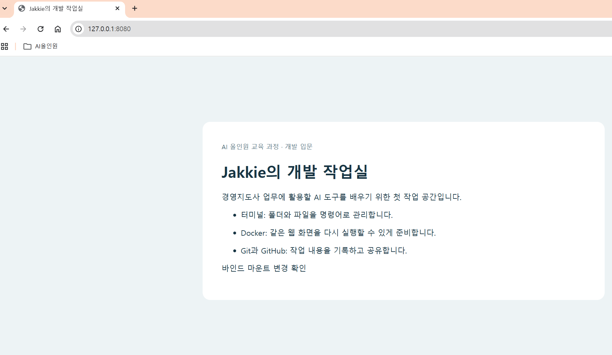
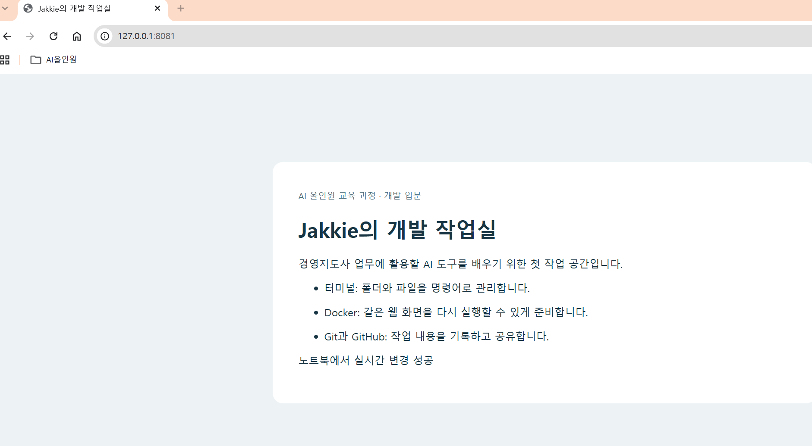
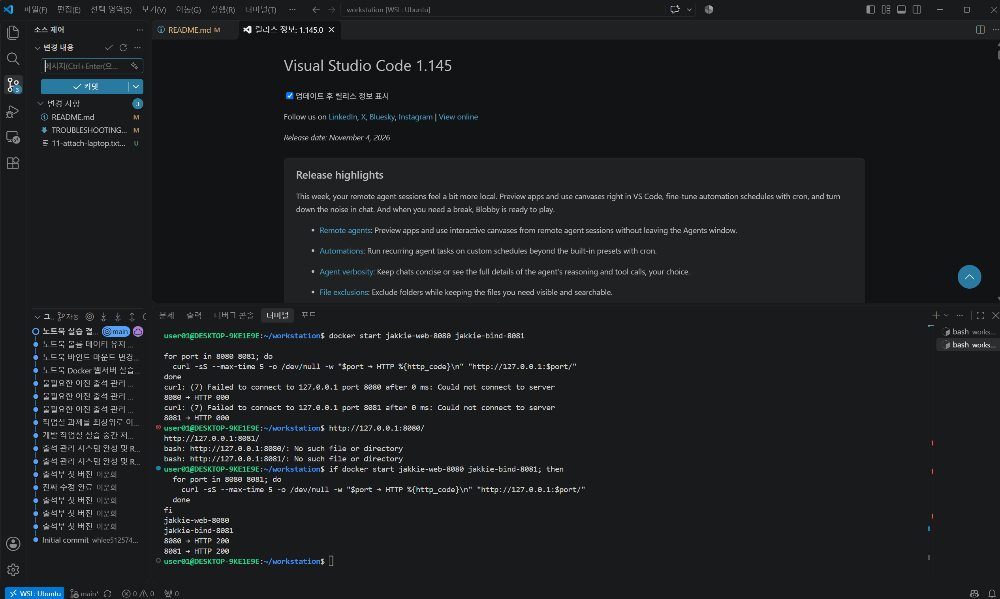

# 내 컴퓨터에 개발자용 작업실 꾸미기

## 1. 프로젝트 소개와 현재 상태
터미널로 파일을 다루고, Docker로 나의 소개 웹 화면을 실행하며, Git과 GitHub로 결과를 관리하는 과제입니다. 비전공자가 직접 설명할 수 있는 중급 수준으로 정리했습니다. 선택 보너스인 Compose와 SSH 키 설정은 제외했습니다.

**현재 상태: 주요 Docker 실습과 GitHub 업로드를 확인했습니다.** 노트북의 Ubuntu에서 웹서버 실행·중지·재시작, 컨테이너 내부 명령 실행, 바인드 마운트 변경 반영, 컨테이너 삭제 후 볼륨 자료 유지를 확인했습니다. 실습 기록은 evidence/07-laptop.txt, evidence/08-bind-laptop.txt, evidence/09-volume-laptop.txt에 저장하고 GitHub에 업로드했습니다. 나머지 항목은 증거를 확인하며 정리 중입니다.

## 2. 실행 환경
권장 작업 기준은 Windows + WSL2 Ubuntu + Bash입니다. PowerShell에 Linux 명령을 그대로 붙여 넣지 말고 Ubuntu 터미널을 엽니다. 폴더는 `/mnt/c`보다 Ubuntu 홈 아래에 두면 권한 실습을 이해하기 쉽습니다.

| 항목 | 실제 확인값 | 확인 방법 |
|---|---|---|
| Windows / WSL | Windows에서 Ubuntu 연결 확인, WSL 버전 추가 확인 필요 | VS Code의 WSL: Ubuntu 표시 |
| Ubuntu | 26.04.1 LTS | cat /etc/os-release |
| Bash | 5.3.9 | bash --version |
| Docker | 클라이언트·서버 모두 29.9.2 | docker --version, docker info |
| Git | 2.53.0 | git --version |
| 편집기 | VS Code에서 Ubuntu 연결 및 파일 편집 확인 | WSL: Ubuntu 표시와 README 편집 |

준비할 도구: WSL2 Ubuntu, Docker Desktop의 Ubuntu 연동, Git, curl, VS Code와 WSL 확장. 설치되지 않았다면 [PC 준비 안내](docs/PC_SETUP.md)를 먼저 봅니다.

## 3. 파일 구성

| 경로 | 역할 |
|---|---|
| `Dockerfile` | NGINX에 소개 화면을 넣는 이미지 제작 파일 |
| `site/index.html` | 직접 수정하는 웹 화면 |
| `docs/RUNBOOK.md` | 한 단계씩 수행하는 CLI 절차 |
| `docs/INTERVIEW.md` | 별도 문제 제시와 인터뷰형 질의·답변서 |
| `docs/TROUBLESHOOTING.md` | 문제 확인 및 해결 기록 양식 |
| `evidence/` | 실제 출력과 화면 증거를 저장할 위치 |

## 4. 수행 항목과 증거
[x]는 실습 결과가 확인된 항목입니다. [ ]는 미실행을 뜻하는 것이 아니라, 전체 수행 여부나 증거를 추가로 확인해야 하는 항목입니다.

| 완료 | 필수 항목 | 수행·검증 결과 | 기록 위치 |
|---|---|---|---|
| [x] | 터미널 기본 조작 | 데스크톱에서 위치 확인, 파일·폴더 생성, 복사, 이동, 삭제, 내용 확인 완료 | [터미널 실습](evidence/01-terminal.txt) |
| [x] | 파일·폴더 권한 | 데스크톱에서 파일 600→644, 폴더 700→755 변경 및 결과 확인 | [권한 실습](evidence/01-terminal.txt) |
| [x] | Docker 설치·엔진 | 클라이언트·서버 버전 29.9.2 확인 | [환경 정보](evidence/10-laptop-environment.txt) |
| [x] | Docker 운영 | 이미지 다운로드·목록, 컨테이너 목록·로그·자원 사용량, 중지·재시작 확인 | [Docker 실습](evidence/03-docker.txt) |
| [x] | 컨테이너 실습 | hello-world 정상 종료, Ubuntu 컨테이너에서 exec 실행, 노트북 실습 컨테이너에서 attach 연결 후 exit로 정상 종료(0) 확인 | [hello-world·exec](evidence/03-docker.txt) · [attach](evidence/11-attach-laptop.txt) |
| [x] | 커스텀 이미지 | Dockerfile로 이미지를 만들고, 실행 후 HTTP 200 OK 확인 | [이미지 제작·실행](evidence/03-docker.txt) |
| [x] | 포트 매핑 | 8080·8081의 웹 화면과 curl 출력 확인 | [두 포트 비교](evidence/08-bind-laptop.txt) |
| [x] | 바인드 마운트 | site/index.html 수정 후 8081에 변경 반영, 8080과 차이 확인 | [바인드 마운트](evidence/08-bind-laptop.txt) |
| [x] | 볼륨 영속성 | 기존 컨테이너 삭제 후 새 컨테이너에서 같은 메모 확인 | [볼륨 실습](evidence/09-volume-laptop.txt) |
| [x] | Git·GitHub·VS Code | VS Code의 Ubuntu 연결·편집, Git 작성자 설정·commit·push 성공 확인 | [노트북 실습](evidence/07-laptop.txt) |
| [x] | 트러블슈팅 2건 | Git 작성자 미설정과 VS Code 단축키 문제의 원인·해결·재확인 기록 | [트러블슈팅](docs/TROUBLESHOOTING.md) |

## 5. 실행 순서
압축을 풀고 `workstation` 폴더 전체를 Ubuntu 홈 아래로 복사합니다. 예를 들어 `~/codyssey/workstation`입니다. 실제 압축 해제 위치는 PC마다 다르므로 먼저 `pwd`와 `ls -la`로 확인합니다.

[실습 절차서](docs/RUNBOOK.md)를 1번부터 진행합니다. 모든 명령은 Bash에서 직접 실행합니다. 결과를 그대로 복사해 `evidence/`에 기록합니다. 예상 성공 기준은 설명이며 실행 증거가 아닙니다.

빠른 웹 실행은 Docker 엔진이 정상 연결된 상태에서 Dockerfile이 있는 폴더에서 다음과 같습니다.

```bash
docker build -t jakkie-workroom:1.0 .
docker run -d --name jakkie-web-8080 -p 127.0.0.1:8080:80 jakkie-workroom:1.0
curl -i http://localhost:8080
```

브라우저 주소창에 `http://localhost:8080`을 입력합니다. 위 명령을 다시 실행하기 전에 같은 이름의 컨테이너가 있는지 `docker ps -a`로 확인합니다.

## 6. 핵심 개념을 쉬운 말로 설명하기

- 절대경로는 `/home/사용자/codyssey/workstation/site`처럼 전체 주소이고, 상대경로 `./site`는 현재 폴더에서 찾는 주소입니다.
- 권한은 소유자·그룹·기타 사용자 순서입니다. r=4, w=2, x=1을 더합니다. 644는 6(읽기+쓰기), 4(읽기), 4(읽기)입니다. 755는 7(읽기+쓰기+실행/접근), 5, 5입니다. 폴더의 x는 안으로 들어가 경로를 탐색하는 권한입니다.
- 이미지는 실행할 환경을 담은 원본이고, 컨테이너는 그 원본으로 실제 실행한 작업 공간입니다.
- `8080:80`은 PC의 8080번 입구와 컨테이너의 80번 입구를 연결합니다. 두 공간이 구분되어 있으므로 연결이 필요합니다. `EXPOSE 80`만으로 PC 포트가 열리지는 않습니다.
- 바인드 마운트는 내 PC 폴더를 연결합니다. 파일 수정은 다음 요청 때 보이고, 브라우저는 새로고침해야 합니다.
- 볼륨은 Docker가 관리하는 저장 공간입니다. 연결한 컨테이너를 삭제해도 볼륨 자체를 삭제하지 않으면 파일을 다시 읽을 수 있습니다.
- Git은 내 PC에서 변경 이력을 기록하고, GitHub는 원격에 저장하고 공유합니다.

## 7. 제출 전 확인

1. 절차서 전 항목을 직접 실행하고 실제 로그를 저장합니다.
2. README의 환경표·체크표를 실제 결과에 맞게 수정합니다.
3. [트러블슈팅](docs/TROUBLESHOOTING.md)에 실제 2건 또는 명확히 구분한 재현 실습을 작성합니다.
4. 브라우저 주소창 포함 2개 화면과 VS Code 연동 화면을 첨부합니다.
5. 아래 증거 링크는 파일 저장 후 활성화됩니다. 누락 파일을 만든 것으로 표시하지 않습니다.

[터미널](evidence/01-terminal.txt) · [환경](evidence/02-environment.txt) · [Docker](evidence/03-docker.txt) · [웹·마운트](evidence/08-bind-laptop.txt) · [볼륨](evidence/09-volume-laptop.txt) · [노트북 실습](evidence/07-laptop.txt) · [attach 실습](evidence/11-attach-laptop.txt)





6. 비밀번호·토큰·개인키·인증코드가 없는지 확인 후 GitHub에 올립니다.
7. 최종 제출 링크: **[workstation GitHub 저장소](https://github.com/whlee5125740-afk/workstation)**. 평가자가 접근할 수 있는 권한인지 확인합니다.

## 8. 학습 정리 작성란
처음에는 터미널과 브라우저 중 어디에 입력해야 하는지 헷갈렸습니다. `curl`로 8080과 8081의 응답을 확인하고, 바인드 마운트로 연결한 8081에서 파일 수정이 바로 반영되는 것을 확인했습니다. `docker ps -a`로 컨테이너의 종료 상태를 확인하는 방법도 익혔습니다. 다음에는 브라우저를 열기 전에 Docker Desktop의 실행 상태와 웹서버 응답부터 확인하겠습니다.

## 9. 참고
첨부 미션 요구사항과 참고 README의 필수 구성만 반영했습니다. 선택 보너스와 고급 운영 내용은 제외했습니다.
- https://docs.docker.com/engine/storage/bind-mounts/
- https://docs.docker.com/engine/storage/volumes/
- https://docs.docker.com/engine/containers/run/
- https://docs.docker.com/engine/network/port-publishing/

## Git 설정 및 원격 저장소 증거

이 저장소의 Git 작성자 설정과 `origin`의 fetch·push 주소를 실제 CLI 출력으로 확인했습니다.
[Git 설정 및 원격 저장소 CLI 기록](evidence/12-git-config-remote.md)

## Docker 볼륨과 포트 충돌 추가 증거

[볼륨 보관 위치와 8080 포트 충돌 오류 원문](evidence/13-docker-volume-port.md)
